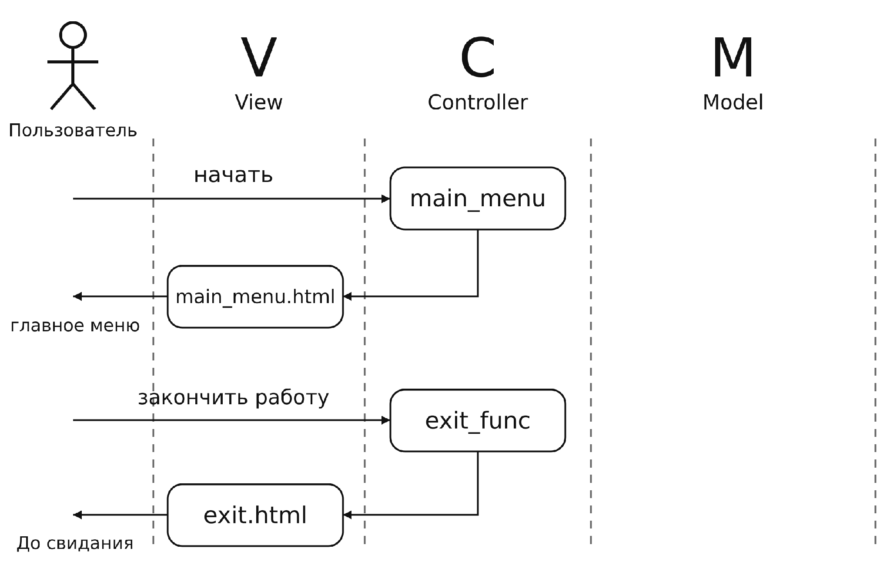
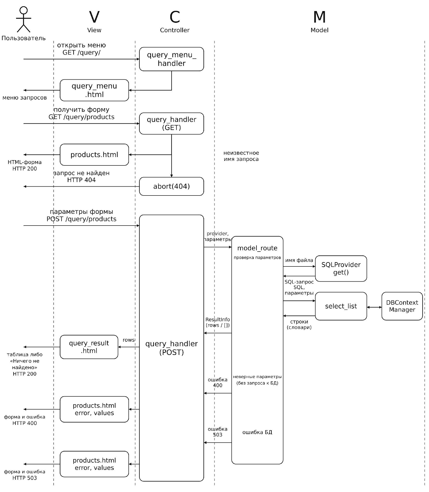

# Лабораторная работа № 1. Работа с запросами

## 1. Главное меню

**Название варианта использования:** Главное меню.

**Основной актор:** Пользователь информационной системы «Супермаркет».

**Предусловия:** Веб-приложение запущено; пользователь открывает адрес системы в браузере.

**Гарантия успеха:** Отображено главное меню; пользователь может перейти к запросам или закончить работу.

### Основной успешный сценарий

1. Пользователь открывает главную страницу системы.
2. Система показывает главное меню с пунктами «Работа с запросами» и «Закончить работу».
3. Пользователь выбирает «Работа с запросами».
4. Система отображает меню параметризованных запросов.

### Альтернативный сценарий и исключения

- 3а. Пользователь выбирает «Закончить работу». Система отображает страницу «До свидания»; сценарий завершается.
- 1а. Веб-сервер недоступен: страница меню не получена. После восстановления соединения пользователь повторяет открытие системы.

### 1.1. Системная диаграмма Главного меню

Рис. 1. Системная диаграмма последовательности Главного меню

## 2. Работа с запросами

**Название варианта использования:** Работа с запросами.

**Основной актор:** Пользователь информационной системы «Супермаркет».

**Предусловия:** Пользователь открыл главное меню. Для выполнения запросов настроено подключение к PostgreSQL и созданы таблицы БД.

**Гарантия успеха:** Выполнен выбранный параметризованный запрос; результат отображён в виде таблицы.

### Основной успешный сценарий

1. Пользователь выбирает «Работа с запросами» в главном меню.
2. Система показывает меню из трёх запросов.
3. Пользователь выбирает нужный запрос.
4. Система отображает форму ввода параметров.
5. Пользователь вводит параметры и нажимает «Выполнить запрос».
6. Система проверяет параметры, выполняет SQL-запрос и отображает таблицу результатов.
7. Пользователь просматривает результат и выбирает повтор запроса, возврат в меню запросов или в главное меню.

### Альтернативы и исключения

- 2а. В меню запросов пользователь выбирает «Вернуться в главное меню». Система отображает Главное меню; вариант использования завершается.
- 3а. При прямом обращении по адресу неизвестного запроса сервер возвращает HTTP 404. Для продолжения пользователь открывает меню запросов.
- 4а. Пользователь выбирает возврат из формы в меню запросов или в Главное меню. Система отображает выбранную страницу без выполнения SQL-запроса.
- 6в. Одна из дат отсутствует, не распознаётся как дата либо начальная дата позже конечной. Система возвращает форму с введёнными значениями и пояснением ошибки.
- 6д. Не настроено подключение, БД недоступна или возникла ошибка выполнения SQL. Система возвращает форму с сохранением значений и сообщением «База данных недоступна. Попробуйте позже.», HTTP 503. Технические детали записываются в журнал сервера.

### 2.1. Системная диаграмма работы с запросами

Рис. 2. Системная диаграмма последовательности работы с запросами
