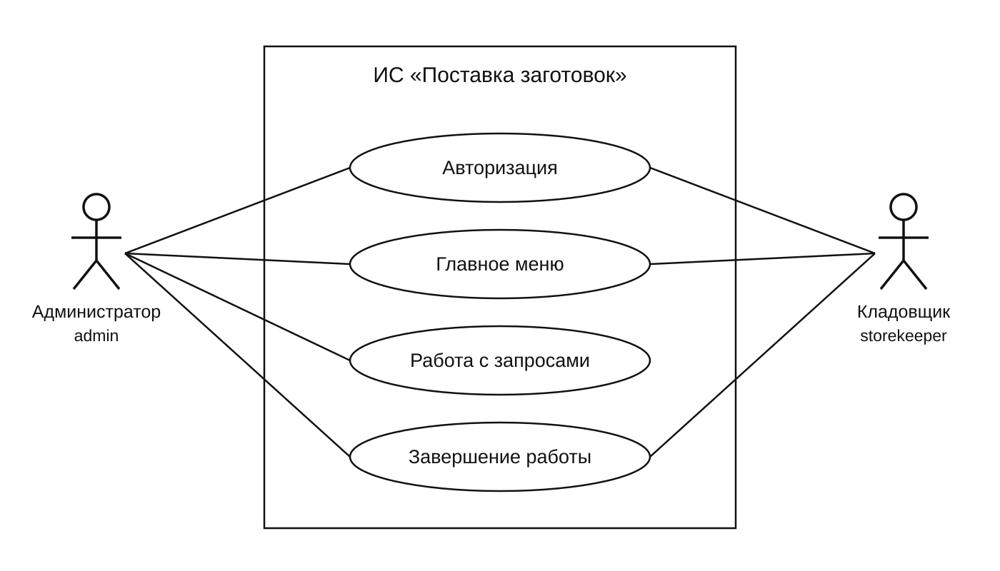
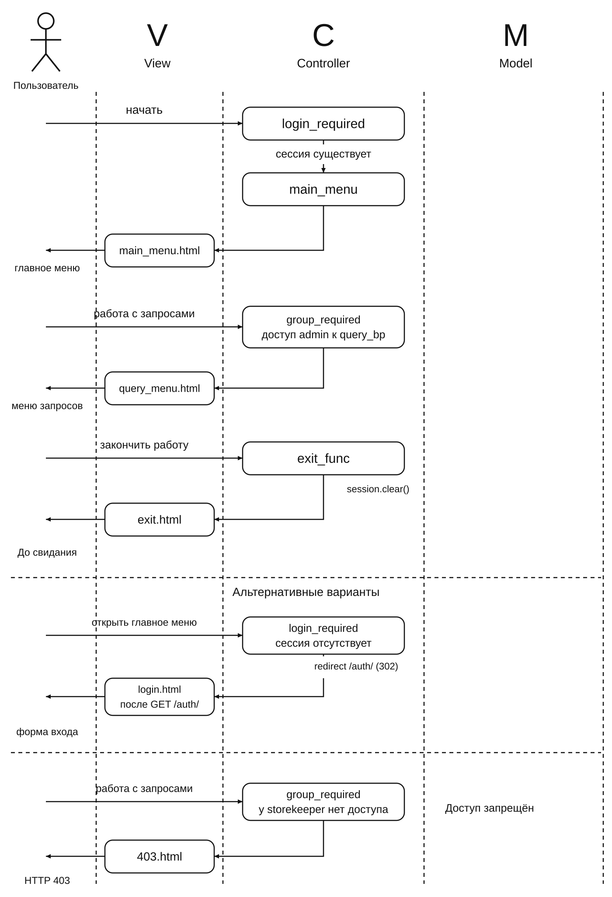
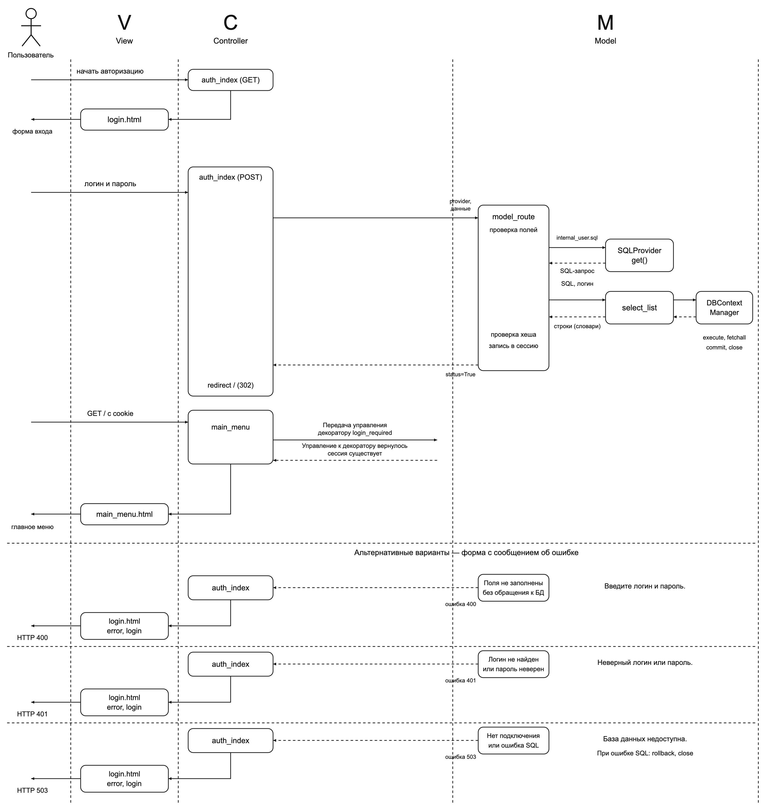

# Лабораторная работа № 2. Авторизация внутренних пользователей

Индивидуальный вариант 4 — «Поставка заготовок». [Текст задания с фотографии](../variant-4.md).

## 1. Системная диаграмма вариантов использования

Рис. 1. Системная диаграмма вариантов использования ИС «Поставка заготовок»

## 2. Система авторизации внутренних пользователей

Пользователь вводит логин и пароль. Система находит учётную запись в таблице `internal_user` и проверяет хеш пароля. При успешном входе идентификатор и группа пользователя сохраняются в сессии Flask, после чего открывается главное меню.

Администратор (`admin`) имеет доступ к запросам. Кладовщик (`storekeeper`) может открыть главное меню и закончить работу, но не имеет доступа к запросам. Права групп заданы словарём `access.json` и проверяются декоратором `group_required`. Декоратор `login_required` проверяет авторизацию перед открытием главного меню. При завершении работы сессия очищается.

## 3. Главное меню

**Название варианта использования:** Главное меню.

**Основной актор:** Внутренний пользователь информационной системы «Поставка заготовок».

**Предусловия:** Веб-приложение запущено; пользователь открывает адрес системы в браузере.

**Гарантия успеха:** Авторизованному пользователю отображено главное меню.

### Основной успешный сценарий

1. Пользователь открывает главную страницу системы.
2. Система проверяет авторизацию с помощью декоратора `login_required`.
3. Система показывает главное меню с пунктами «Работа с запросами» и «Закончить работу».
4. Администратор выбирает «Работа с запросами».
5. Система проверяет права группы и отображает меню запросов.

### Альтернативный сценарий и исключения

- 2а. Пользователь не авторизован: система перенаправляет его на форму входа.
- 4а. Пользователь выбирает «Закончить работу»: система очищает сессию и отображает страницу «До свидания».
- 5а. У группы нет права на запросы: система показывает страницу «Доступ запрещён», HTTP 403.
- 1а. Веб-сервер недоступен: пользователь повторяет открытие системы после восстановления соединения.

### 3.1. Системная диаграмма Главного меню

Рис. 2. Системная диаграмма последовательности Главного меню

### 3.2. Требования к шаблонам

- `main_menu.html`: название системы, заголовок «Главное меню», ссылки «Работа с запросами» и «Закончить работу».
- `exit.html`: сообщение «До свидания» и ссылка «Войти снова».
- `403.html`: сообщение «Доступ запрещён» и ссылка в главное меню.

## 4. Авторизация

**Название варианта использования:** Авторизация.

**Основной актор:** Внутренний пользователь информационной системы «Поставка заготовок».

**Предусловия:** Приложение запущено; в БД создана учётная запись пользователя.

**Гарантия успеха:** Параметры пользователя сохранены в сессии; отображено главное меню.

### Основной успешный сценарий

1. Пользователь начинает авторизацию.
2. Система показывает форму ввода логина и пароля.
3. Пользователь вводит данные и нажимает «Войти».
4. Система проверяет логин и пароль.
5. Система сохраняет идентификатор и группу пользователя в сессии.
6. Система передаёт управление в главное меню.

### Альтернативы и исключения

- 4а. Логин или пароль не заполнен: система возвращает форму с сообщением «Введите логин и пароль.», HTTP 400.
- 4б. Логин или пароль неверен: система возвращает форму с сообщением «Неверный логин или пароль.», HTTP 401.
- 4в. БД недоступна: система возвращает форму с сообщением «База данных недоступна. Попробуйте позже.», HTTP 503.
- При ошибке введённый логин сохраняется, поле пароля очищается. Пользователь может повторить ввод.

### 4.1. Системная диаграмма авторизации

Рис. 3. Системная диаграмма последовательности авторизации

### 4.2. Требования к шаблону

`login.html`: заголовок «Авторизация», обязательные поля «Логин» и «Пароль», кнопка «Войти». Пароль отображается скрытым вводом. Форма отправляется методом POST. При ошибке выводится сообщение с сохранением логина; пароль в форме не сохраняется.

## 5. База данных и запросы индивидуального варианта

Используется отдельная локальная база PostgreSQL `workpieces`. Её таблицы:

| Таблица | Данные |
| --- | --- |
| `workpiece_type` | Код и название типа заготовок: прокат, поковки, отливки, штамповки |
| `workpiece` | Уникальный код, название, тип, вес в кг, материал заготовки |
| `stock_balance` | Код заготовки, цена, количество на складе, дата последнего обновления |
| `supplier` | Уникальный номер, название, город, телефон и дата заключения договора |
| `invoice` | Уникальный номер накладной, поставщик, дата поставки и общая стоимость |
| `invoice_item` | Номер накладной, код заготовки, цена и поставленное количество |
| `internal_user` | Идентификатор пользователя, логин, хеш пароля и группа |

Первичный ключ `stock_balance` состоит из кода заготовки и цены: одна заготовка по разным ценам учитывается раздельно. Тип заготовки заменяет категорию товаров исходного варианта. Поставщик должен быть зарегистрирован с датой заключения договора, прежде чем на него можно сослаться в накладной. Внешние ключи защищают связи между таблицами, ограничения запрещают отрицательные цены и остатки, неположительные вес и количество в строке накладной.

Приложение предоставляет администратору три запроса:

1. Заготовки выбранного типа: код, название, тип, вес, материал, цена, остаток и дата обновления. Заготовка выводится отдельной строкой для каждой цены.
2. Поставщики выбранного города: номер, название, город, телефон и дата договора.
3. Накладные поставщика за период: номер, дата, поставщик и сумма. Обе граничные даты включаются целиком, время учитывается по Москве.

Начальные данные содержат поставки за февраль — апрель 2020 года. Остатки и даты обновления рассчитываются при заполнении по строкам накладных; суммы накладных соответствуют суммам их строк. В рамках ЛР‑2 данные доступны только для чтения. Разработка процедуры и триггера из индивидуального задания отложена по согласованию с владельцем.

Учебные записи: `admin` / `admin` и `storekeeper` / `storekeeper`. Это группы пользователей приложения; подключение к PostgreSQL задаётся отдельно в конфигурации.

Порядок создания БД, загрузки данных, запуска приложения и проверок приведён в [README](../../../README.md). Проверки PostgreSQL запускаются при заданной переменной `LAB1_TEST_DB_CONFIG` и используют собственную временную схему; проверяют запросы, раздельные остатки по ценам, согласованность начальных данных, ограничения БД, авторизацию обеих групп и транзакции.
