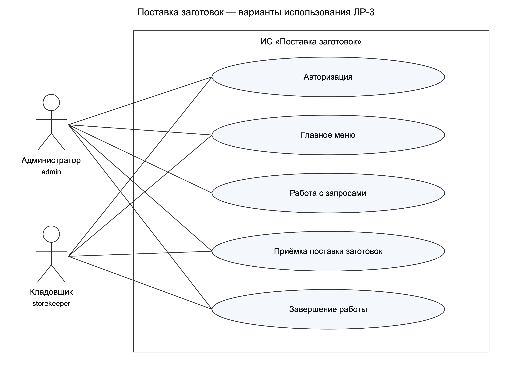
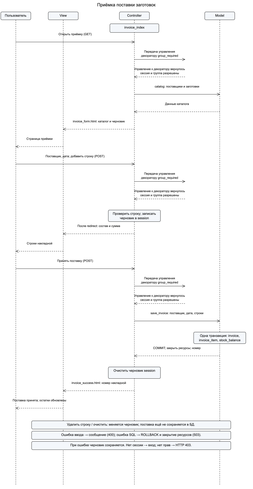
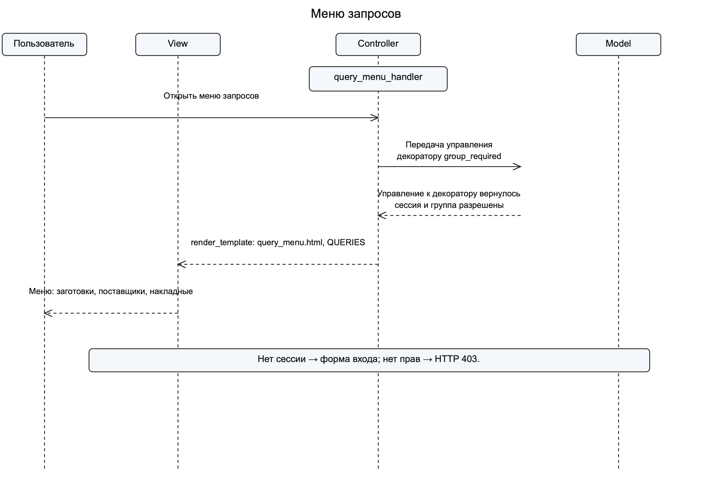
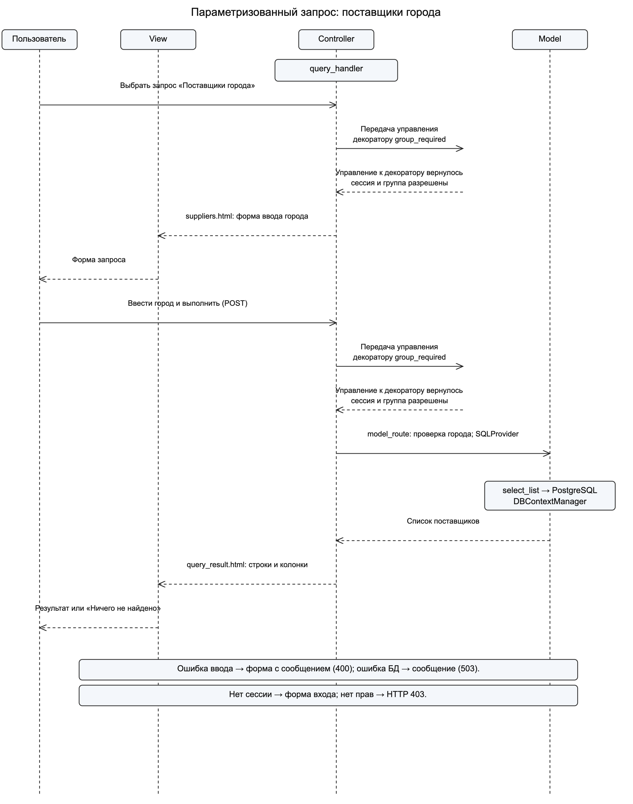

# Лабораторная работа № 3. Работа с запросами и основной бизнес-процесс

Индивидуальный вариант 4 — «Поставка заготовок». [Текст задания с фотографии](../variant-4.md).

## 1. Системная диаграмма вариантов использования



Рис. 1. Системная диаграмма вариантов использования ИС «Поставка заготовок»

### 1.1. Авторизация внутренних пользователей

1. **Кому раздаются права.** Внутренним пользователям ИС «Поставка заготовок»: администратору и кладовщику.
2. **На что раздаются права.** Обе группы могут открыть главное меню, принять поставку и закончить работу. Администратору дополнительно доступна работа с запросами. Кладовщику запросы недоступны. Права заданы в `app/data/access.json`.
3. **Что должен ввести пользователь, чтобы авторизоваться.** Логин и пароль своей учётной записи в форме входа.
4. **Чем заканчивается процесс авторизации.** При верных данных система показывает главное меню. При неверных данных пользователь остаётся на форме входа и видит сообщение об ошибке; он может исправить данные и повторить попытку. Без авторизации обращение к запросам или приёмке открывает форму входа, при отсутствии права — страницу «Доступ запрещён», HTTP 403.

Завершение работы очищает сессию вместе с незавершённой накладной. Уже принятые поставки сохраняются в БД.

## 2. Основной бизнес-процесс «Приёмка поставки заготовок»

**Название варианта использования:** Приёмка поставки заготовок.

**Основной актор:** Кладовщик информационной системы «Поставка заготовок». Вариант использования также доступен администратору.

**Предусловия:** Приложение запущено и подключено к PostgreSQL; пользователь авторизован и имеет право приёмки; поставщик заключил договор и зарегистрирован; заготовки внесены в справочник.

**Гарантия успеха:** Пользователь видит номер сохранённой накладной; поступившее количество учтено на складе отдельно по каждой цене.

### Основной успешный сценарий

1. Пользователь выбирает в главном меню «Приёмка поставки заготовок».
2. Система показывает поставщиков, поле даты, каталог заготовок и состав накладной.
3. Пользователь выбирает поставщика и дату, вводит цену и количество заготовки и нажимает «Добавить».
4. Система показывает новую строку, сумму строки и общую сумму накладной.
5. Пользователь повторяет добавление для остальных заготовок.
6. Система показывает заполненную накладную и итоговую сумму.
7. Пользователь нажимает «Принять поставку».
8. Система показывает сообщение «Поставка принята» и номер накладной, предлагает принять следующую поставку или вернуться в меню.

### Альтернативы и исключения

- 1а. Нет авторизации: система показывает форму входа.
- 1б. У группы нет права приёмки: система показывает страницу 403.
- 3а. Пользователь нажимает «Удалить» у строки: система удаляет строку и пересчитывает сумму.
- 3б. Пользователь нажимает «Очистить»: система очищает состав, сохраняя поставщика и дату.
- 3в. Пользователь возвращается в меню: черновик остаётся доступен до завершения сеанса.
- 4а. Цена или количество не заполнены: система показывает «Введите цену и количество.» и сохраняет ранее добавленные строки. Пользователь заполняет поля и повторяет добавление. Формат чисел задаётся полями формы.
- 8а. Накладная пуста, поставщик или дата не выбраны: система показывает сообщение и оставляет состав для исправления. Пользователь заполняет недостающие данные и повторяет приёмку.
- 8б. Ошибка БД: система сообщает об ошибке. Поставка не сохраняется частично, черновик остаётся для повторной отправки после восстановления работы БД.

### 2.1. Системная диаграмма последовательности приёмки поставки



Рис. 2. Системная диаграмма последовательности приёмки поставки заготовок

Проверка доступа условно показана исходящей и обратной стрелками у обработчика Controller. В коде обёртка `group_required` выполняется до тела обработчика.

### 2.2. Структуры данных основного бизнес-процесса

Черновик находится в `session['invoice_draft']`:

```python
{
    'supplier_id': '1',
    'delivered_at': '2026-11-19',
    'lines': [
        {'workpiece_id': 1, 'price': '950.00', 'quantity': 2},
        {'workpiece_id': 1, 'price': '1000.00', 'quantity': 3}
    ]
}
```

Цена хранится строкой, при расчётах преобразуется в `Decimal`. Количество — положительное целое число. Каждое добавление создаёт отдельную строку, в том числе при совпадении кода и цены. Сумма строки равна произведению цены и количества; итог — сумме строк. Номер автоматически формируется PostgreSQL.

| Таблица | Данные приёмки |
| --- | --- |
| `supplier` | Поставщик и дата договора |
| `workpiece`, `workpiece_type` | Каталог заготовок |
| `invoice` | Номер, поставщик, дата поставки, общая сумма |
| `invoice_item` | Накладная, заготовка, цена, количество |
| `stock_balance` | Количество и дата для пары «заготовка + цена» |

Дата вводится без времени и сохраняется как полночь по Москве. Количество остатка увеличивается; отсутствующий остаток создаётся. Дата остатка заменяется датой принимаемой поставки, включая поставку задним числом.

Модуль `invoice_bp` содержит `route.py`, `model_route.py`, `sql/` и `templates/`. SQL загружается существующим `SQLProvider`. Накладная, строки и остатки сохраняются в одном `DBContextManager`: успех — commit, ошибка — rollback, ресурсы закрываются. Черновик очищается после успешной фиксации. Процедуры, триггеры и Redis для этого процесса не используются. Новых зависимостей нет.

### 2.3. Требования к шаблонам

| Шаблон | Отображаемые данные | Ввод и действия пользователя |
| --- | --- | --- |
| `invoice_form.html` | Список поставщиков, каталог заготовок слева, состав накладной справа; цена, количество и сумма каждой строки, общая сумма, сообщение об ошибке или пустом составе | Выбор поставщика и даты, ввод цены и количества; «Добавить», «Удалить», «Очистить», «Принять поставку», «Вернуться в меню» |
| `invoice_utils.html` | Макрос карточки заготовки: код, название, тип, материал, вес | Числовое поле цены с шагом 0,01 и минимальным значением 0; целочисленное поле количества с минимальным значением 1; кнопка «Добавить» |
| `invoice_success.html` | Сообщение «Поставка принята», номер накладной, подтверждение обновления остатков | «Принять следующую поставку», «Вернуться в меню» |

Страницы наследуют `base.html`, данные экранируются Jinja. При ошибке сохраняются выбранный поставщик, дата, строки и введённые поля каталога. Карточка каталога реализована макросом по образцу корзины из практического занятия. На странице используется общая форма: нажатая кнопка определяет добавление, удаление, очистку или приёмку. Главное меню содержит ссылку «Приёмка поставки заготовок».

## 3. Вариант использования «Работа с запросами»

**Название варианта использования:** Работа с запросами.

**Основной актор:** Администратор информационной системы «Поставка заготовок».

**Предусловия:** Приложение запущено и подключено к PostgreSQL; пользователь авторизован в группе `admin` и открыл главное меню.

**Гарантия успеха:** Пользователь видит результат выбранного запроса или сообщение об отсутствии записей.

### Основной успешный сценарий

1. Пользователь выбирает «Работа с запросами» в главном меню.
2. Система показывает меню: заготовки выбранного типа, поставщики выбранного города, накладные поставщика за период.
3. Пользователь выбирает запрос «Поставщики из выбранного города».
4. Система показывает поле ввода города.
5. Пользователь вводит город и нажимает «Выполнить запрос».
6. Система показывает код, название, город, телефон и дату договора найденных поставщиков.
7. Пользователь выбирает повтор запроса, возврат в меню запросов или главное меню.
8. Система показывает выбранную страницу.

### Альтернативы и исключения

- 1а. Нет авторизации: система показывает форму входа.
- 1б. Нет права работы с запросами: система показывает страницу 403.
- 2а. Пользователь выбирает «Вернуться в главное меню»: система показывает главное меню, вариант использования завершается.
- 3а. Пользователь выбирает заготовки: система предлагает ввести код типа, затем показывает заготовки с остатками отдельно по каждой цене.
- 3б. Пользователь выбирает накладные: система предлагает ввести поставщика и границы периода, затем показывает номер, дату, поставщика и сумму накладных. Обе даты включаются в период по Москве.
- 4а. Пользователь выбирает возврат в меню запросов или главное меню: система показывает выбранную страницу без выполнения запроса.
- 6а. Неверные параметры: система показывает сообщение и сохраняет введённые значения. Пользователь исправляет параметры и повторяет выполнение.
- 6б. Записей нет: система показывает «Ничего не найдено».
- 6в. Ошибка БД: система показывает сообщение «База данных недоступна. Попробуйте позже.» и сохраняет введённые значения. Пользователь повторяет запрос после восстановления работы БД.

### 3.1. Системная диаграмма последовательности меню запросов



Рис. 3. Системная диаграмма последовательности меню запросов

### 3.2. Системная диаграмма последовательности параметризованного запроса



Рис. 4. Системная диаграмма последовательности запроса поставщиков выбранного города

### 3.3. Требования к шаблонам

| Шаблон | Отображаемые данные | Ввод и действия пользователя |
| --- | --- | --- |
| `query_menu.html` | Названия трёх параметризованных запросов | Выбор запроса, «Вернуться в главное меню» |
| `query_form.html` | Название запроса, поля конкретного запроса, сообщение об ошибке | «Выполнить запрос», возврат в меню запросов или главное меню |
| `workpieces.html` | Поле «Код типа заготовок» | Ввод кода типа целым положительным числом |
| `suppliers.html` | Поле «Город» | Ввод названия города |
| `invoices.html` | Поля кода поставщика, начальной и конечной даты; пояснение о включении обеих дат | Ввод поставщика и периода |
| `query_result.html` | Название запроса, заголовки и строки таблицы; при пустой выдаче — «Ничего не найдено» | «Повторить запрос», возврат в меню запросов или главное меню |

Формы конкретных запросов наследуют `query_form.html`; страницы меню, общей формы и результата наследуют `base.html`. Введённые значения возвращаются в форму при ошибке. Используется ранее реализованный `query_bp` с авторизацией внутренних пользователей.

## 4. Запуск и проверка

Локальное окружение использует `compose.yaml` и конфигурацию `docker/db_config.json`. Адрес `db` доступен внутри Docker. Изменений схемы и новых зависимостей для ЛР-3 не требуется.

```sh
docker compose up -d --build web
docker compose exec -e LAB1_TEST_DB_CONFIG=/app/app/data/db_config.json web python -m unittest discover -v
```

Приложение: <http://127.0.0.1:5000>. Учебные учётные записи: `admin` / `admin`, `storekeeper` / `storekeeper`.

Прошли все 39 тестов, включая PostgreSQL: доступ групп, отдельные строки, разные цены, удаление и очистка, суммы, создание и увеличение остатков, приёмка задним числом, сохранение черновика и полный откат при ошибке второй строки. Тесты PostgreSQL используют собственную временную схему и удаляют её после завершения.

HTTP-проверка страницы приёмки без авторизации возвращает перенаправление на `/auth/`; после входа кладовщика форма доступна. SVG и PNG диаграмм проверены визуально. Визуальная проверка интерфейса в браузере не выполнена: хост управления браузером недоступен.
